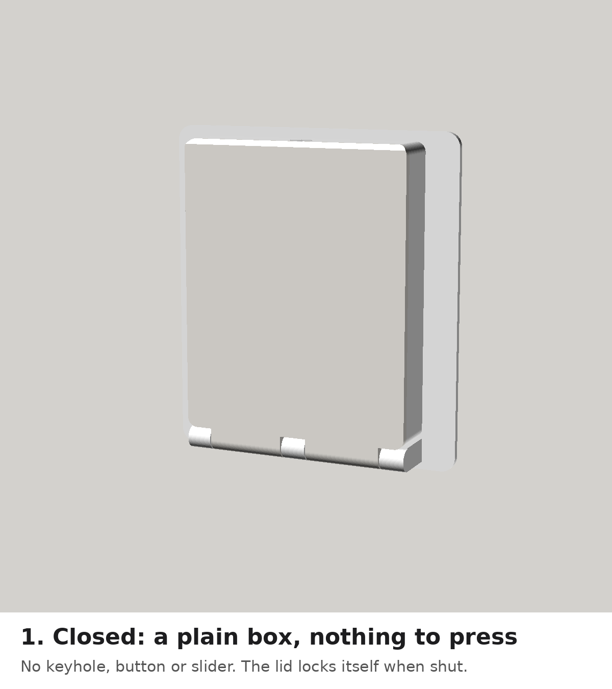
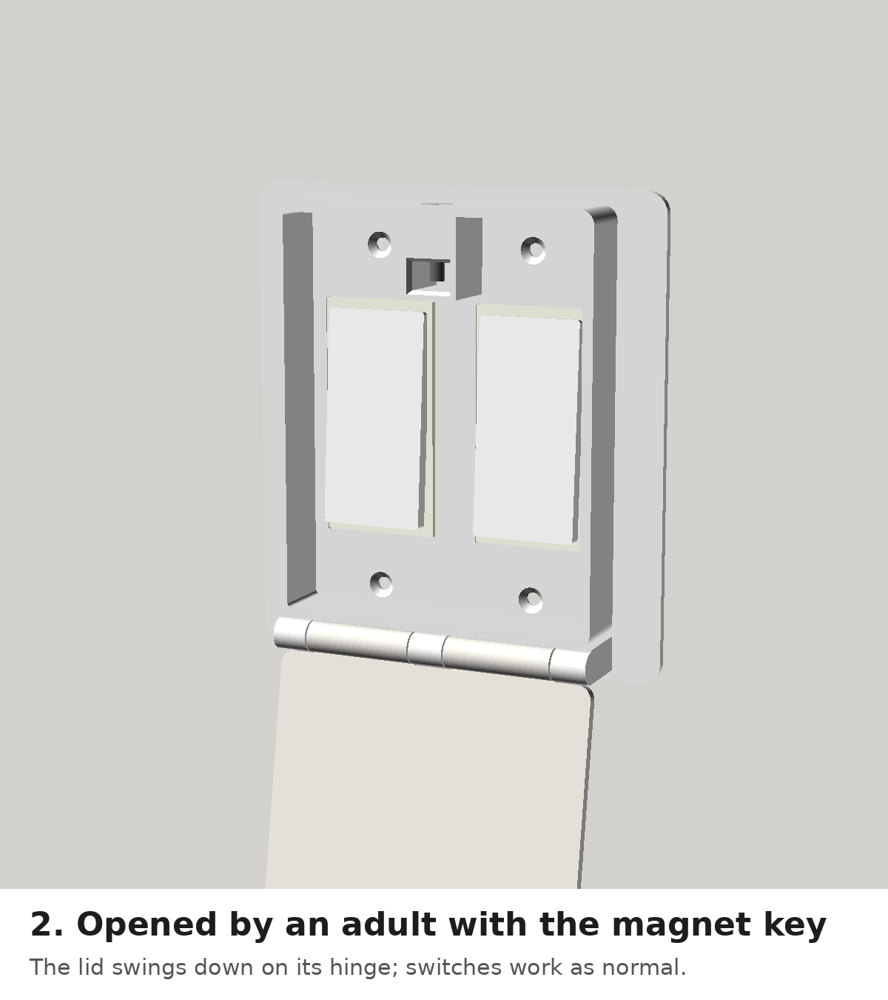
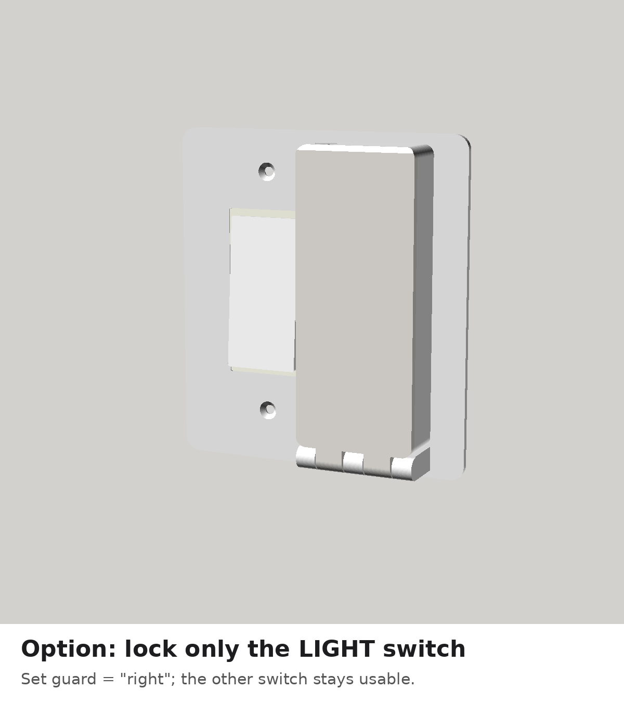
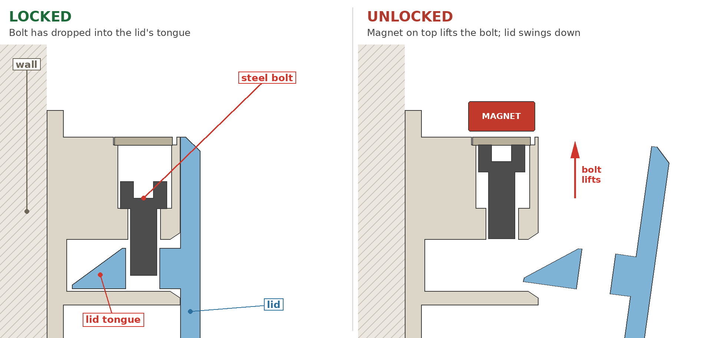

# Hidden-Latch Switch Guard

A replacement wall plate for a **2-gang Decora (rocker) switch** with a lid that
**locks itself every time it is closed**. From the outside it's a plain box. There's
no keyhole, button, slider or label for a curious child to work at. An adult opens it
by holding a magnet on top of the box.

| Opened by an adult | Lock only the LIGHT switch |
|---|---|
|  |  |

## How it works

1. A short steel bolt hangs in a hidden channel at the top of the box.
2. When you push the lid shut, a ramp on the lid's tongue lifts the bolt. The bolt then
   drops by gravity through a hole in the tongue, and the lid is **locked**. You don't
   have to remember to lock it.
3. To open it, hold a strong magnet on the **top** of the box above the latch. The
   magnet pulls the bolt up out of the tongue and the lid swings down on its hinge.
   Use the switch, then push the lid back up until it clicks.

The four wall-plate screws are inside the box, so a child can't unscrew it either.

These checks were run in this repo (the numbers come from the model):

- Lid vs. box: no overlap at any angle from 0° to 170°.
- Bolt: clears the box and lid when the lid is shut.
- Closing: the ramp passes **under** the bolt instead of jamming into it (0.9 mm margin).
- Bolt travel while closing: 4.2 mm, inside the 5.5 mm of room.
- Unlocked: the lid swings out with 1.3 mm of clearance under the lifted bolt.
- Locked: the bolt sits 4 mm deep in the tongue.

## What you need

| Item | Notes |
|---|---|
| 3D-printed parts | `stl/hood_*.stl`, `stl/lid_*.stl`, `stl/cap.stl`. No printer? Upload the STLs to a print service, or try your local library or makerspace. |
| M4 × 10 mm socket-head screw (this is the bolt) | **Alloy steel (black oxide), not stainless.** Stainless is barely magnetic. Check it sticks to your magnet. |
| 3 mm steel rod, or M3 threaded rod | The hinge pin. Cut to **91 mm** (both switches) or **45 mm** (one switch). |
| Neodymium magnet, about 20 mm × 10 mm (¾" × ⅜"), N52 | This is the "key". Buy two and keep a spare. |
| Super glue | For the cap and the hinge rod. |

Print settings: PETG (tougher than PLA), 0.2 mm layers, 4 walls, 30–40 % infill,
**no supports**. The STLs are already laid out for printing: the box goes plate-side
down and the lid goes front-face down. Add a brim to the lid if the hinge knuckles lift
off the bed. Each part fits on a 220 × 220 mm bed.

## Before you print: measure

The default dimensions are the US standard for 2-gang Decora plates, which is what's in
your photo. Take the old plate off and check:

| Parameter | Default | What to measure |
|---|---|---|
| `gang_spacing` | 46.0 mm (1.81") | Centre of left rocker to centre of right rocker |
| `decora_w` × `decora_h` | 33.3 × 66.8 mm | The rectangular rocker frame |
| `screw_spacing` | 96.8 mm (3.81") | Between the top and bottom plate screw of one switch |

If anything differs, open `switch_guard.scad` in [OpenSCAD](https://openscad.org/).
Change the value in the Customizer panel, then export with *File → Export → STL*.
Set `part` to `hood`, `lid` or `cap` before each export.

**Which switches to cover:** set `guard` to `both` (default), `right` or `left`. With
`right`, only the switch labelled LIGHT is locked and the other one stays usable.

## Assembly and install

1. **Bolt:** drop the M4 screw, head up, into the round hole on top of the box. Glue the
   printed cap into the hole.
2. **Hinge:** line up the lid's knuckles with the box's knuckles. Push the rod in from
   the left end (the right end is closed) and put a drop of glue on the left end.
3. **Test on the table** with the box standing upright, since the latch needs gravity:
   - Push the lid shut. It should click.
   - Pull on the lid. It should stay locked.
   - Hold the magnet on top. The lid should open.
4. **Install:** turn off the breaker as a precaution (no wires are touched). Remove the 4
   screws and the old plate. Screw the new plate on with the same screws, snug but not
   tight. Check that both rockers flip freely. If a rocker rubs, reduce `plate_t`.

## Safety notes

- **Keep the magnet up high and out of reach.** Neodymium magnets are dangerous if a
  child swallows them, especially more than one. The bolt and cap are small parts too.
- **Adults must always be able to get light in an emergency.** Keep the magnet in a
  fixed spot near the switch, for example on top of the door frame. Tell every adult
  and babysitter where it is.
- Use it **only on plain on/off switches**. Don't enclose dimmers or smart switches that
  get warm, because a closed box traps heat.
- This slows a child down; it isn't a vault. Check it now and then for cracks. If a
  child learns to bang the box while pulling the lid, add a light spring above the bolt
  head, inside the cap.

## No 3D printer? Other ways to get the same result

- **Smart switch with the paddle locked out.** Some smart switches can stop the paddle
  from turning the light on or off. For example, Inovelli switches have a
  "Local Protection" setting. The light is then controlled from a phone, a voice
  assistant, a schedule or a remote mounted out of reach. A regular switch elsewhere on
  the same light (3-way wiring) can override it. Hire an electrician if you're not
  comfortable wiring a switch.
- **Key-operated switch.** For example, the Leviton 1221-2KL works only with its key.
  It's a toggle style, so the wall plate changes too. This is a job for an electrician.
- **Lockable switch cover.** Search for "lockable light switch cover". It's cheap and
  needs no wiring, but most are clear, so the switch stays visible and inviting.

**A tip from many parents and OTs:** a lot of kids love switches for the instant
cause-and-effect. A switch of their own often takes the pressure off the wall switch:
a busy board with real rocker switches wired to a battery LED, for example.
